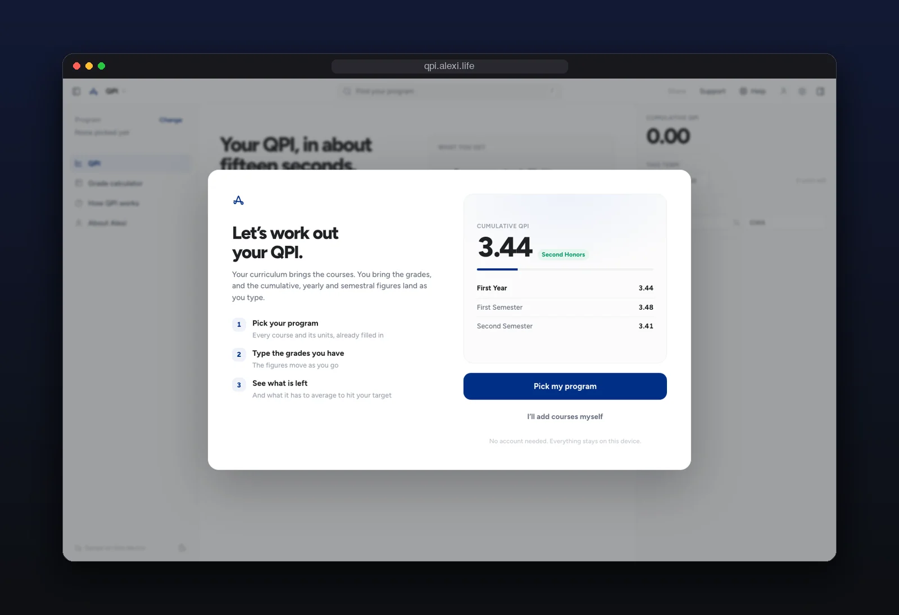

<div align="center">

<br>

# ADMU QPI Calculator

**Your Ateneo QPI, without the spreadsheet.**

Pick your program, enter the grades you have, and get your cumulative QPI.

<a href="https://qpi.alexi.life">qpi.alexi.life</a> ·
<a href="#features">Features</a> ·
<a href="#numbers">Numbers</a> ·
<a href="https://alexi.life/projects/ateneo-qpi-calculator">Case study</a>

<br>


<br>



</div>

<br>

## Features

- **Your whole curriculum.** Pick your program and every course comes pre-filled with its units.
- **AISIS import.** Bring your grades in from AISIS instead of typing them.
- **Every QPI at once.** Cumulative, yearly, and semestral, updating as you type.

<br>

## Numbers

- **9,600+** sessions in its first year
- **131,000+** interactions
- **#2** on Google for "qpi calculator"

<br>

## Stack

Next.js · Tailwind CSS · shadcn/ui · MUI Joy. This is the original 2024 version; [qpi.alexi.life](https://qpi.alexi.life) now runs a newer rebuild.

<details>
<summary><b>Run it locally</b></summary>
<br>

```bash
npm install
npm run dev
```

</details>

<br>

<div align="center">
<sub>an independent student project · not affiliated with Ateneo de Manila University · check AISIS for your official record</sub>
</div>
